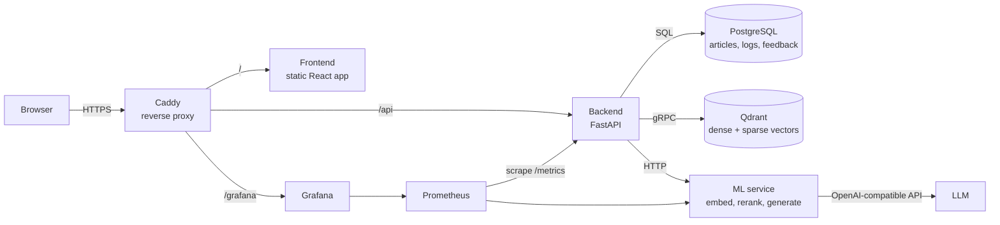
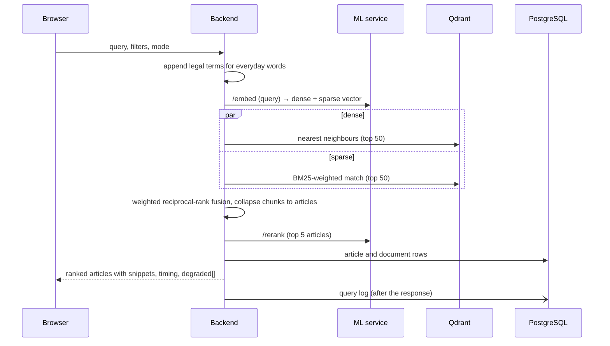
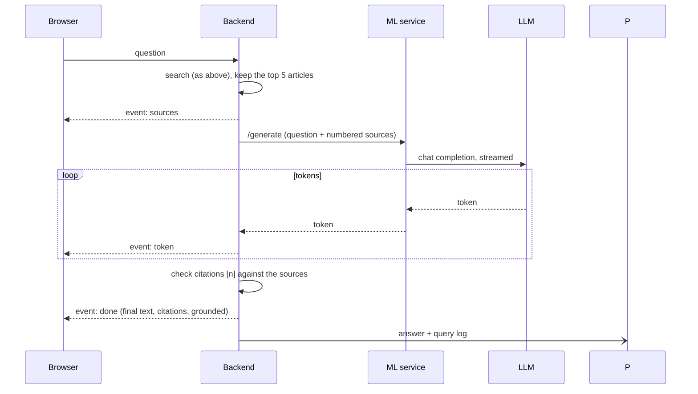
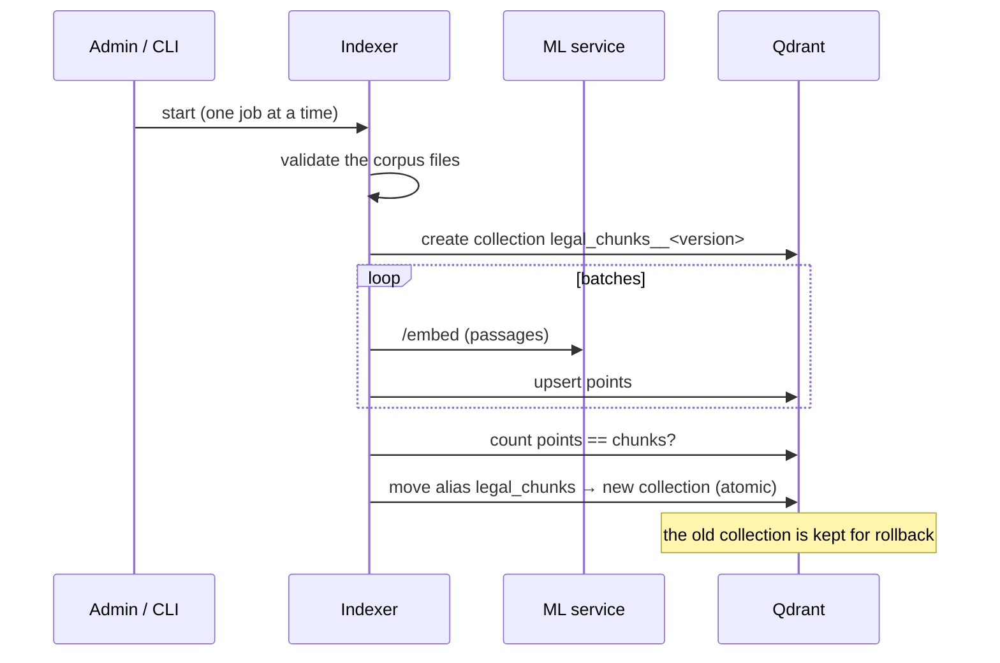
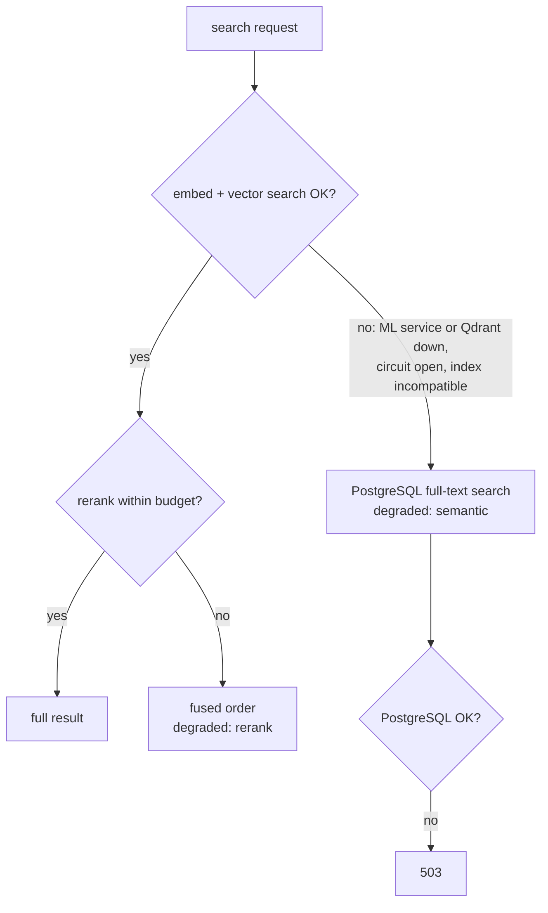
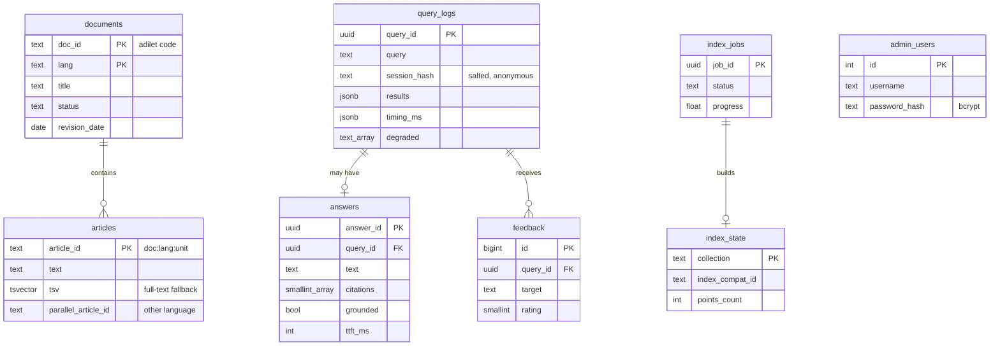

# Architecture

Adilet Search answers a question in Russian or Kazakh with the articles of Kazakhstan legislation that cover it, and can write a short answer that cites those articles.

## Components

| Component | Role | Why this choice |
|---|---|---|
| Frontend | search page, streamed answer, article viewer, admin panel | a static build; no server-side state |
| Backend | the public API: orchestrates search, streams answers, logs queries, admin API | async FastAPI: the work is waiting on other services, so one process handles many requests |
| ML service | the models behind one small internal API | models can change (fine-tuned versions) without touching the backend; `contracts/ml_service.md` is the only link |
| Qdrant | vector index with dense and sparse vectors in one collection | hybrid search in one store; collection aliases give a switch without downtime |
| PostgreSQL | article texts, query logs, answers, feedback, index bookkeeping; full-text fallback | one relational store for everything that is not a vector |
| LLM | writes the answer from the retrieved articles | any OpenAI-compatible endpoint; the system works without it (search only) |

The interfaces are fixed in `contracts/`: `api.md` and `openapi.json` (public API), `ml_service.md` (backend ↔ ML), `data_schema.md` (corpus files).

## Search: `POST /api/v1/search`

- **Query expansion.** People write "зарплата" or "вещдок"; the statutes say "заработная плата" and "вещественные доказательства". A dictionary of 34 such words (`backend/app/services/query_expansion.py`) appends the legal terms to the query that the models and the keyword search see. The user's words are never removed, and the logged and returned query is unchanged.
- **Hybrid retrieval.** The dense vector finds articles that mean the same as the question; the sparse (keyword) vector finds exact terms and article numbers. Reciprocal-rank fusion merges the two lists without tuning score scales.
- **Reranking.** A cross-encoder reads the question together with each of the top 5 articles and reorders them. It is the most expensive stage, so it has its own time budget.
- **Budgets.** Each stage has a timeout (`SEARCH_*_TIMEOUT_S`). The target is p95 ≤ 2 s for the whole request.

## Answer: `POST /api/v1/answer` (Server-Sent Events)

- The sources are sent **before** generation starts, so the user sees the law even if the LLM is slow or down.
- The model may only cite the numbered sources it was given. Citations to anything else are removed, and an answer without valid citations is marked as not grounded.
- SSE (not WebSockets) because the stream goes one way and plain HTTP passes every proxy.

## Reindex without downtime

Search always reads through the alias, so it serves the old index until the instant of the switch. A failed job deletes its own partial collection and changes nothing. Every index records the `index_compat_id` of the models that built it; the backend refuses an index built with other models.

## Degraded modes

A circuit breaker per dependency stops calls after 5 consecutive failures and probes again after 20 s, so a dead service costs no timeouts. If the LLM fails, the answer stream ends with an `error` event after the sources.

## Data model (PostgreSQL)

Vectors live only in Qdrant; each point's payload carries the chunk text and the filter fields (language, document, status, date).

## How the design meets the targets

| Target | How |
|---|---|
| Response time ≤ 2 s | per-stage budgets; the reranker is capped (top 5, 256 tokens) and skipped when slow; query embeddings and responses are cached; measured in `docs/report/load_test.md` |
| Fault tolerance | full-text fallback, circuit breakers, sources before generation, health checks and automatic container restarts |
| Updating the index | versioned collections behind an alias; the old index serves until the new one is complete; rollback is an alias move |
| Scalability | the backend is stateless apart from a per-process cache and rate limiter, so replicas can be added behind the proxy once those move to a shared store; Qdrant and PostgreSQL scale independently |
| Security | `docs/tech/security.md` |
| Observability | request ids in every log line and response; Prometheus metrics per search stage; Grafana dashboard and alert rules |
| Logging and analytics | every query, answer and rating is stored; the admin panel reads them |

## Deployment view

`docker-compose.prod.yml` runs all of the above on one host. Only Caddy publishes ports (80 and 443); the other containers talk on the internal Docker network. Named volumes hold the database, the index, the model cache, the metrics and the certificates. See `docs/tech/deployment.md` and `docs/tech/runbook.md`.
